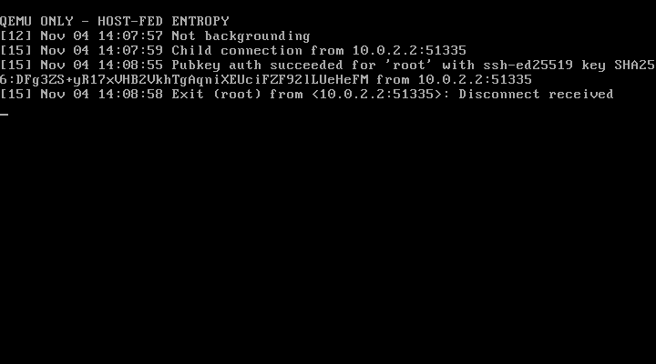
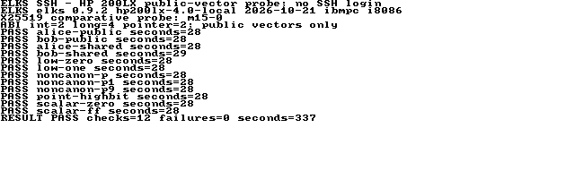
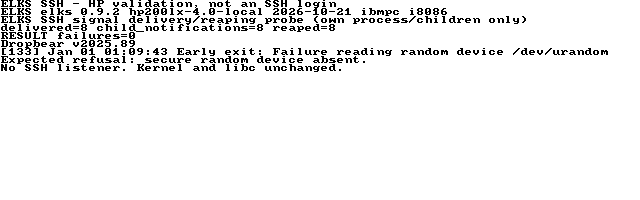
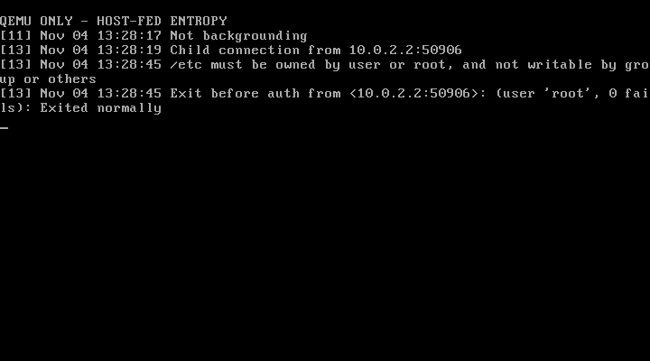
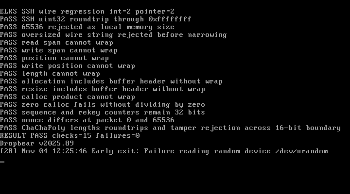

> ⚠️ I’m developing this project with AI assistance out of personal interest. It may not fully align with the ELKS maintainer team’s architectural or development guidelines. Please use it at your own discretion. ⚠️

# ELKS SSH

An experimental continuation of [ghaerr/ssh-daemon-elks](https://github.com/ghaerr/ssh-daemon-elks),
itself forked from [parabyte/ssh-daemon-project](https://github.com/parabyte/ssh-daemon-project),
to bring SSH-2 login and secure file transfer to
[ELKS](https://github.com/ghaerr/elks), starting with the original **8086 and
8088** instruction set. The project builds on existing ELKS user-space APIs;
kernel and architecture changes are out of scope.

**Experimental: public-key login and remote commands work in QEMU with
test-only host entropy. This is not deployment-ready or a release candidate.**
Modern OpenSSH connects with strict host verification and no legacy algorithm
overrides. The normal server refuses startup without secure randomness;
production entropy, interactive sessions and original 8086/8088 execution
remain unvalidated. No SSH listener is running on physical machines.

## Planned suite

| Component | Purpose | Status |
| --- | --- | --- |
| SSH daemon | SSH-2 transport, public-key login, shell and remote commands | QEMU public-key login and commands pass; interactive shell pending |
| SFTP subsystem | Secure file transfers through native ELKS filesystem APIs | Planned |
| Key utility | Public-key display, fingerprints, eventually key generation | Planned |
| SSH/SFTP clients | Outbound connections from ELKS | Later feasibility work |

The existing **Dropbear ELKS port is our starting point**. Its inherited ELKS
deliverable was `dbclient`; our new server build remains experimental. The
inherited source and Git history are preserved. TinySSH was considered as an
alternative; isolated comparative crypto probes live under `feasibility/` and
do not replace the Dropbear protocol implementation.
See [the architecture comparison](docs/DESIGN.md).

## Compatibility commitment

- Compile with `-march=i8086 -mtune=i8086`, without an x87 requirement.
- Audit the **linked executable**, including runtime/library code, for later
  instructions. Do not infer 8086 support from compiler flags alone.
- Test on QEMU with multiple later x86 CPU models and isolated ELKS images.
- Schedule real 8086/8088-class testing separately. QEMU's PC CPU models do
  **not** prove original 8086/8088 execution or hardware performance.
- Keep CPU compatibility separate from ELKS-version and machine compatibility.
  Older ELKS releases, non-PC platforms, NEC CPUs and future releases need
  explicit validation; universal compatibility is a target, not a current claim.

The owner has authorized PPC SSH testing and client screenshots. Hardware
deployment still depends on an appropriate entropy source and a validated
candidate. Preserve other projects' tests and kernel/firmware. The owner has
now made the HP 200LX available for serial testing while they finish PicoMEM
work on the PPC. See [HP hardware progress](docs/HP200LX-PROGRESS.md).

## Build and test

See [BUILDING](docs/BUILDING.md) for the prepared ELKS toolchain, remote-build
workflow and disposable QEMU tests. Testing tools are separate from the minimal
external build path. The proposed integration follows ELKS's `buildext.sh` and
`elkscmd/ExtApplications` conventions; probes are not automatically installed
as a login service.

See [SESSION-PROGRESS](docs/SESSION-PROGRESS.md) for current results and limitations, and
[ROADMAP](docs/ROADMAP.md) for the staged development plan.

The latest checkpoint uses MINIX filesystem permissions with the unchanged ELKS
kernel. Login, stdin/EOF, automated PTY commands (`ps` and `cat /etc/issue`) and
forced rekeying pass on QEMU's 486 model. The Pentium suite
also checks larger output, repeated login, exit status, child cleanup, rejection
of incorrect client/host keys and unsafe key-file permissions, and the single
unauthenticated connection limit. ELKS uses `authkeys` because its MINIX
filesystem limits names to 14 characters. See [reproduction instructions](docs/BUILDING.md).

Actual QEMU guest console showing successful public-key authentication and
disconnect. Fresh host/client keys and host-fed session entropy are confined to
the disposable test. See [results, memory samples and limitations](docs/LOGIN-PROGRESS.md)
and the unresolved [production entropy strategy](docs/ENTROPY.md).

The [physical HP 200LX checkpoint](docs/HP200LX-PROGRESS.md) passed all ten crypto
probe checks, but the batch took 19 minutes 19 seconds. The normal daemon loads
and now passes signal setup after an application link-order fix, then correctly
refuses startup without `/dev/urandom`. See the [controlled hardware comparison](docs/SIGNAL-LAYOUT.md).
Crypto performance and hardware entropy remain prerequisites for a usable
hardware SSH service.

A subsequent [matched X25519 comparison](docs/X25519-COMPARISON.md) reduced one
HP scalar multiplication from 235 to 28 seconds using an isolated BearSSL m15
probe, which then passed all 12 HP vectors in 337 seconds. The faster variant
costs more code space; a smaller variant failed the
16-bit tests. The daemon still uses Dropbear's existing crypto. This is progress
toward practical hardware performance, not an SSH handshake measurement.

Actual ELXcap capture of the completed probe's saved output on the HP console.

Actual ELXcap console capture; this is a hardware probe, not an SSH login.

The [native Windows client preflight](docs/WINDOWS-TESTING.md) confirms OpenSSH
9.5p2 and the required algorithm support on the Surface. A Windows-to-ELKS
connection and the [requested physical PPC screenshots](docs/PPC-CAPTURE.md)
remain pending.

Earlier checkpoints established [crypto/OS probes](docs/VALIDATION.md),
[16-bit wire handling](docs/SERVER-PROGRESS.md) and
[SSH transport](docs/SOCKET-PROGRESS.md). Both standalone probes pass the static
8086 instruction audit. The normal daemon now also passes the static audit
for its recorded binary hash; actual original 8086/8088 execution and full
hardware SSH operation remain unverified. See [the HP checkpoint](docs/HP200LX-PROGRESS.md).

This earlier capture shows the authorization-path permission rejection after
successful key exchange and host verification, using test-only host entropy.
See [transport evidence and limitations](docs/SOCKET-PROGRESS.md).

The server capture shows the expected refusal without secure randomness.
[Current test evidence](docs/SERVER-PROGRESS.md) includes build logs and hashes.

Actual emulator capture, not an SSH login or hardware test. Capture provenance
and the serial transcript are in [VALIDATION](docs/VALIDATION.md).

## Architecture guidance

The design follows the layering, maintainability and regression-testing advice
in [ghaerr's PicoMEM discussion](https://github.com/ghaerr/elks/discussions/2841#discussioncomment-19387609)
and [ELKSWeb external-build guidance](https://github.com/ghaerr/elks/discussions/2185#discussioncomment-19053594).
Those discussions do not constitute endorsement or approval of this SSH project.
The detailed [project constraints](docs/DESIGN-CONSTRAINTS.txt) are retained here.

Reliable session randomness, total memory/stack usage, account isolation,
packet bounds and practical handshake time remain feasibility gates. A missing
OS capability will be documented rather than worked around with a kernel hack.

This repository is a public fork, as authorized by the project owner after the
existing public ELKS port was found. An invitation for ghaerr is deferred until
a first viable release candidate is ready for independent testing.

## License and provenance

Inherited code retains the upstream [LICENSE](LICENSE). New feasibility code is
MIT licensed under [feasibility/LICENSE](feasibility/LICENSE); new regression
tests use [tests/LICENSE](tests/LICENSE). Other third-party
licenses are described in [THIRD_PARTY](THIRD_PARTY.md). Development uses AI
coding assistance. Test results distinguish host, emulator and real hardware.
