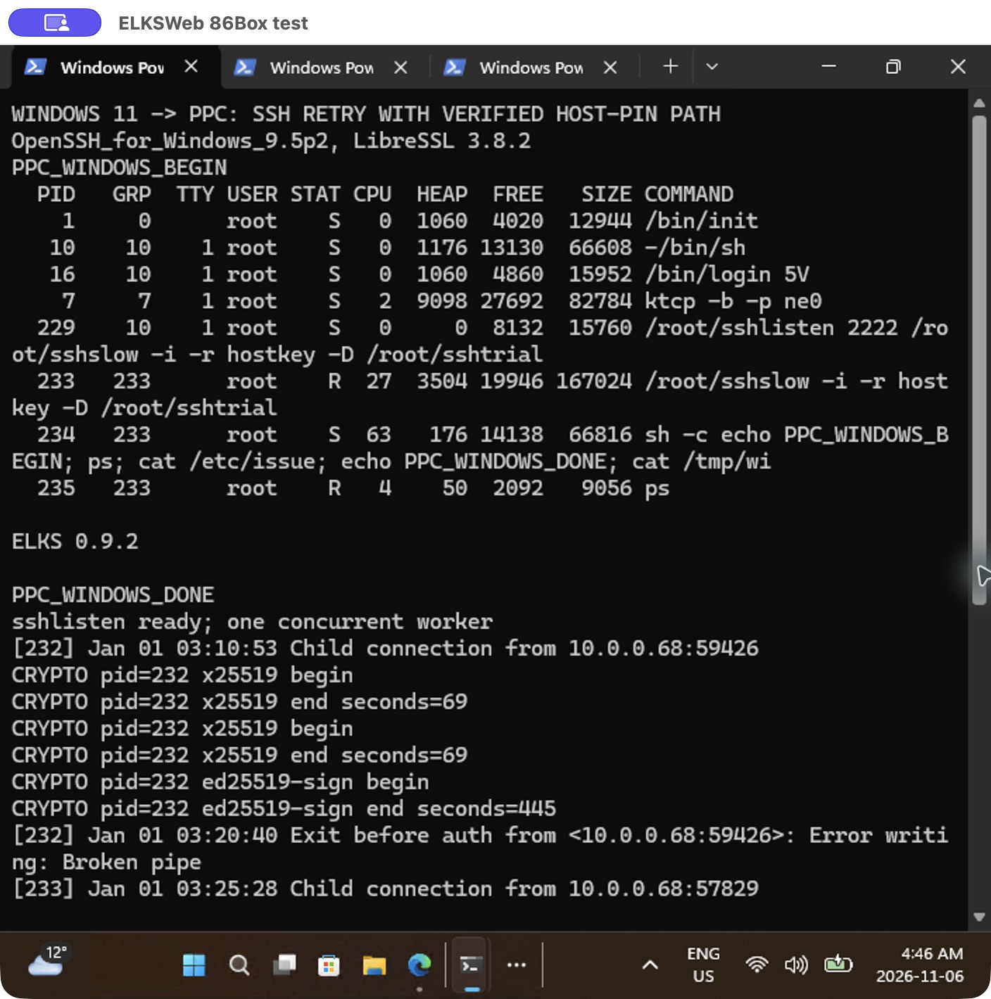
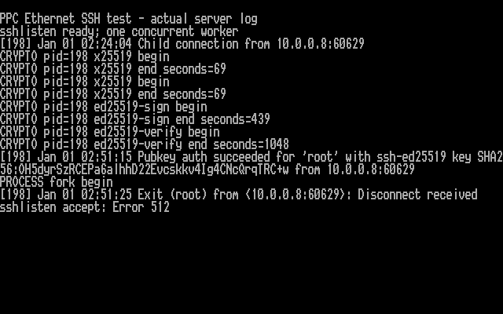
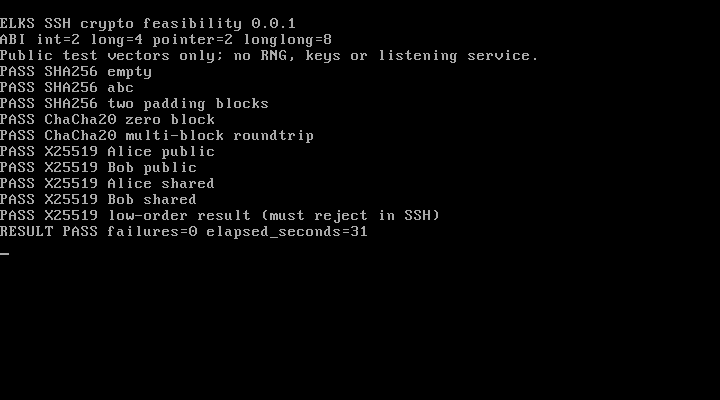

> ⚠️ I’m developing this project with AI assistance out of personal interest. It may not fully align with the ELKS maintainer team’s architectural or development guidelines. Please use it at your own discretion. ⚠️

> **Proof of concept — “will it work?” on retro hardware.** This is a hobby and
> learning effort to demonstrate modern SSH on ELKS, not a production-ready or
> everyday remote-access service. Successful PPC command tests took **26 minutes
> 14.8 seconds from macOS** and **28 minutes 49.6 seconds from Windows**. These
> are complete connection-and-command times, dominated by authentication, using
> different experimental builds; they are not a Mac-versus-Windows benchmark.
> This demonstrates that it works, but the current implementation is impractical
> for routine access on the tested PPC. Faster machines may perform better;
> no recommended minimum CPU has yet been established by hardware measurements.
>
> For convenient everyday access to an **isolated retro lab**, Telnet may be the
> more practical choice, with SSH kept as an optional experiment. Telnet provides
> the same basic remote-terminal function, but **does not provide SSH's encryption,
> integrity protection or authenticated server identity**: credentials and session
> contents are exposed. That is an explicit convenience-versus-security trade-off,
> not equivalent security. Use dedicated credentials, avoid sensitive data and
> Internet exposure. This documentation does not automatically enable Telnet or
> fall back to it when SSH fails. SSH remains experimental, not a release candidate.

# ELKS SSH

An experimental continuation of [ghaerr/ssh-daemon-elks](https://github.com/ghaerr/ssh-daemon-elks),
itself forked from [parabyte/ssh-daemon-project](https://github.com/parabyte/ssh-daemon-project),
to bring SSH-2 login and secure file transfer to
[ELKS](https://github.com/ghaerr/elks), starting with the original **8086 and
8088** instruction set. The project builds on existing ELKS user-space APIs;
kernel and architecture changes are out of scope.

**Experimental: public-key login and remote commands work in QEMU and have
completed physical PPC command tests from macOS and native Windows OpenSSH
with independently provisioned persistent random state and no runtime entropy helper.
This is not deployment-ready or a release candidate.**
Modern OpenSSH connects with strict host verification and no legacy algorithm
overrides. The normal server refuses startup without secure randomness;
production qualification and full interactive controls remain unvalidated.
Both native clients verified the pinned host key, authenticated, ran `ps` and
`cat /etc/issue`, and exited zero. Tests use an explicit 30-minute diagnostic
authentication profile and a small single-worker launcher. The broader Windows
matrix and full interactive qualification remain open.

## Successful physical PPC command tests

| Client / test | Whole-session elapsed time | Retained evidence |
| --- | --- | --- |
| macOS OpenSSH 10.3p1, field-O2 candidate | **26m 14.8s** | [Result](docs/evidence/20261106-ppc-field-o2/mac/mac-result.json), [command output](docs/evidence/20261106-ppc-field-o2/mac/mac-command.txt); native Terminal screenshot pending |
| Windows OpenSSH 9.5p2 on Surface Laptop, earlier slow profile | **28m 49.6s** | [Native screenshots and result](docs/WINDOWS-TESTING.md) |
| Earlier Mac session, slow profile | **27m 34.23s** | [Result and PPC console capture](docs/ED25519-COMPARISON.md) |

**Windows → PPC: actual native Windows Terminal capture**

Captured through Windows App from the completed original session. Both command
markers and ELKS 0.9.2 are visible. The server log beneath them includes an
initial unsuccessful attempt before the successful retry.
[Native exit-zero and timing screenshot](docs/screenshots/windows-ppc-ssh-exit.png).

**Mac → PPC: PPC-side capture from the earlier successful 27m34.23s test**

Actual PPC text framebuffer rendered with its captured ROM font, showing the
server log for the earlier Mac session. **This is not a Mac Terminal screenshot
and does not depict the newer 26m14.8s run.** Its shutdown error is retained;
[listener cleanup corrections and limitations](docs/LISTENER-SHUTDOWN.md) are
tracked separately. The native Mac Terminal capture is still pending user upload
because the computer-control tool blocks access to that application.

The Windows session exposed an unreaped worker in the earlier listener. The
newer listener passes QEMU and physical banner/disconnect cleanup checks, but
post-session cleanup of the latest Mac login still awaits serial maintenance.
Successful commands do not establish complete service reliability.

A compiler-only candidate reduced physical PPC public-probe signing and
verification times by about 11% (252 and 596 seconds). Its native Mac SSH
command session completed in **26 minutes 14.8 seconds**, exit zero: about
4.8% less elapsed time than the earlier Mac run, based on one run each.
A separate user-space listener correction
passes the [expanded cleanup regression](docs/LISTENER-SHUTDOWN.md), which now
checks unnamed zombie entries that the earlier test missed.

The isolated Ed25519 adapter passes 646 host cases, 175 ELKS emulator cases,
seven physical PPC public checks and 15 combined QEMU session/signature cases.
The full PPC service takes longer than the small probe: signing 439 seconds
and verification 1048 seconds. See the
[Ed25519 comparison and actual PPC captures](docs/ED25519-COMPARISON.md), and
the earlier [process-memory diagnostics](docs/PPC-SSH-DIAGNOSTICS.md).

The finished service targets **Ethernet-only machines with no serial cable**.
It must operate independently after one-time secure provisioning, with no
companion host or LAN helper. Serial entropy is a laboratory fixture. The
standalone experiment now passes [11 QEMU SSH/session cases](docs/PERSISTENT-SSH.md)
and three source-failure cases. The [persistent-state experiment](docs/PERSISTENT-STATE.md)
also passes public-data PPC interruption and recovery power-cycle checks.
Broader storage/security qualification and repeated hardware testing remain open;
see the [deployment requirements](docs/RNG-DEPLOYMENT.md).

## Planned suite

| Component | Purpose | Status |
| --- | --- | --- |
| SSH daemon | SSH-2 transport, public-key login, shell and remote commands | QEMU suites and physical PPC command sessions from Mac and Windows pass; performance and interactive shell pending |
| SFTP subsystem | Secure file transfers through native ELKS filesystem APIs | Planned |
| Key utility | Public-key display, fingerprints and native key generation | Isolated Ed25519 generation passes QEMU; hardware initialization unresolved |
| SSH/SFTP clients | Outbound connections from ELKS | Later feasibility work |

The existing **Dropbear ELKS port is our starting point**. Its inherited ELKS
deliverable was `dbclient`; our new server build remains experimental. The
inherited source and Git history are preserved. TinySSH was considered as an
alternative; isolated comparative crypto probes live under `feasibility/` and
do not replace the Dropbear protocol implementation.
See [the architecture comparison](docs/DESIGN.md).

## Compatibility commitment

- Compile with `-march=i8086 -mtune=i8086`, without an x87 requirement.
- Audit the **linked executable**, including runtime/library code, for later
  instructions. Do not infer 8086 support from compiler flags alone.
- Test on QEMU with multiple later x86 CPU models and isolated ELKS images.
- Schedule real 8086/8088-class testing separately. QEMU's PC CPU models do
  **not** prove original 8086/8088 execution or hardware performance.
- Keep CPU compatibility separate from ELKS-version and machine compatibility.
  Older ELKS releases, non-PC platforms, NEC CPUs and future releases need
  explicit validation; universal compatibility is a target, not a current claim.

The owner has authorized PPC SSH testing and client screenshots. Hardware
deployment still depends on an appropriate entropy source and a validated
candidate. Preserve other projects' tests and kernel/firmware. The owner has
made both machines available again. The PPC serial entropy fixture is stopped;
independent operation is now the priority. The HP remains on its serial
console with networking stopped. Its tests passed crypto probes and daemon
loading, then refused missing randomness; no HP SSH login has succeeded.
See [HP hardware progress](docs/HP200LX-PROGRESS.md).

## Build and test

See [BUILDING](docs/BUILDING.md) for the prepared ELKS toolchain, remote-build
workflow and disposable QEMU tests. Testing tools are separate from the minimal
external build path. The proposed integration follows ELKS's `buildext.sh` and
`elkscmd/ExtApplications` conventions; probes are not automatically installed
as a login service.

See [SESSION-PROGRESS](docs/SESSION-PROGRESS.md) for current results and limitations, and
[ROADMAP](docs/ROADMAP.md) for the staged development plan.

The normal-daemon checkpoint uses MINIX filesystem permissions with the unchanged ELKS
kernel. Login, stdin/EOF, automated PTY commands (`ps` and `cat /etc/issue`) and
forced rekeying pass on QEMU's 486 model. The Pentium suite
also checks larger output, repeated login, exit status, child cleanup, rejection
of incorrect client/host keys and unsafe key-file permissions, and the single
unauthenticated connection limit. ELKS uses `authkeys` because its MINIX
filesystem limits names to 14 characters. See [reproduction instructions](docs/BUILDING.md).

Actual QEMU guest console showing successful public-key authentication and
disconnect. Fresh host/client keys and host-fed session entropy are confined to
the disposable test. See [results, memory samples and limitations](docs/LOGIN-PROGRESS.md)
and the unresolved [production entropy strategy](docs/ENTROPY.md).

The [physical HP 200LX checkpoint](docs/HP200LX-PROGRESS.md) passed all ten crypto
probe checks, but the batch took 19 minutes 19 seconds. The normal daemon loads
and now passes signal setup after an application link-order fix, then correctly
refuses startup without `/dev/urandom`. See the [controlled hardware comparison](docs/SIGNAL-LAYOUT.md).
Crypto performance and hardware entropy remain prerequisites for a usable
hardware SSH service.

A subsequent [matched X25519 comparison](docs/X25519-COMPARISON.md) reduced one
HP scalar multiplication from 235 to 28 seconds using an isolated BearSSL m15
probe, which then passed all 12 HP vectors in 337 seconds. The faster variant
costs more code space; a smaller variant failed the
16-bit tests. The normal daemon still uses Dropbear's existing crypto. This is progress
toward practical hardware performance, not an SSH handshake measurement.

Actual ELXcap capture of the completed probe's saved output on the HP console.

Actual ELXcap console capture; this is a hardware probe, not an SSH login.

The physical client captures and exact timings are shown above. See the
[Windows test record](docs/WINDOWS-TESTING.md) and [Mac capture status](docs/PPC-CAPTURE.md).

Earlier checkpoints established [crypto/OS probes](docs/VALIDATION.md),
[16-bit wire handling](docs/SERVER-PROGRESS.md) and
[SSH transport](docs/SOCKET-PROGRESS.md). Both standalone probes pass the static
8086 instruction audit. The normal daemon now also passes the static audit
for its recorded binary hash; actual original Intel 8086/8088 execution remains
unverified. The separate slow diagnostic profile has now completed a PPC command
session. See also [the HP checkpoint](docs/HP200LX-PROGRESS.md).

This earlier capture shows the authorization-path permission rejection after
successful key exchange and host verification, using test-only host entropy.
See [transport evidence and limitations](docs/SOCKET-PROGRESS.md).

The server capture shows the expected refusal without secure randomness.
[Current test evidence](docs/SERVER-PROGRESS.md) includes build logs and hashes.

Actual emulator capture, not an SSH login or hardware test. Capture provenance
and the serial transcript are in [VALIDATION](docs/VALIDATION.md).

## Architecture guidance

The design follows the layering, maintainability and regression-testing advice
in [ghaerr's PicoMEM discussion](https://github.com/ghaerr/elks/discussions/2841#discussioncomment-19387609)
and [ELKSWeb external-build guidance](https://github.com/ghaerr/elks/discussions/2185#discussioncomment-19053594).
Those discussions do not constitute endorsement or approval of this SSH project.
The detailed [project constraints](docs/DESIGN-CONSTRAINTS.txt) are retained here.

Reliable session randomness, total memory/stack usage, account isolation,
packet bounds and practical handshake time remain feasibility gates. A missing
OS capability will be documented rather than worked around with a kernel hack.

This repository is a public fork, as authorized by the project owner after the
existing public ELKS port was found. An invitation for ghaerr is deferred until
a first viable release candidate is ready for independent testing.

## License and provenance

Inherited code retains the upstream [LICENSE](LICENSE). New feasibility code is
MIT licensed under [feasibility/LICENSE](feasibility/LICENSE); new regression
tests use [tests/LICENSE](tests/LICENSE). Other third-party
licenses are described in [THIRD_PARTY](THIRD_PARTY.md). Development uses AI
coding assistance. Test results distinguish host, emulator and real hardware.

The [experimental m15 daemon integration](docs/M15-DAEMON.md) passes X25519
vectors and SSH public-key authentication, but cannot execute a shell because
ELKS returns `ENOMEM`. An Ed25519 probe ordering failure and target timing
security concerns also remain open. This backend has not been promoted.

On the [PPC with vanilla ELKS](docs/PPC-VANILLA.md), four X25519 RFC vectors
pass and both daemon variants load when tested alone, then correctly refuse
missing secure randomness. Networking autostart was configured in that earlier
checkpoint. The later independently provisioned diagnostic profile now has successful
hardware SSH command sessions, as described above.

The [dedicated serial entropy prototype](docs/SERIAL-ENTROPY.md) now passes
70 QEMU probe cases, 12 daemon startup cases and 10 physical PPC probe cases.
The PPC daemon accepts a fresh seed and reaches host-key loading; relaunch
without a new bootstrap is refused. Subsequent physical disconnect/reconnect
testing exposed intermittent serial failures; see the follow-up below.
Hardware SSH login was not established with that serial fixture. The later
independent-state tests above succeeded. The ordinary build is unchanged.

The [serial recovery follow-up](docs/SERIAL-RECOVERY.md) records intermittent
short responses at 9600 baud and ten successful restarts at 1200 baud. Its
framed adapter passes the full QEMU SSH suite. This remains lab evidence;
Ethernet-only deployment is now the priority.
