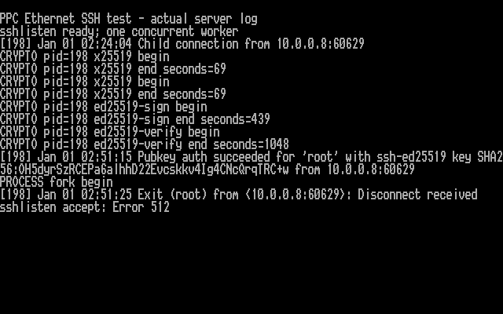
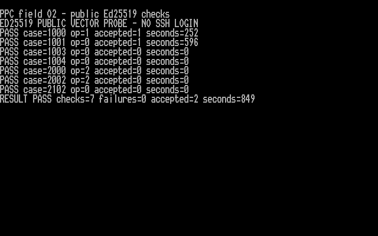

# Isolated Ed25519 comparison — 2026-11-05

This experiment keeps the inherited Dropbear SSH-2 protocol and authentication
code, and compares Daniel Beer's c25519 Ed25519 arithmetic with the inherited
implementation. It combines the existing BearSSL m15 X25519 adapter, persistent
random state and small single-worker launcher. The normal build is unchanged.
This is a diagnostic candidate, not a release candidate or a security audit.

## Input rules and provenance

Unmodified c25519 sources come from the 2017-10-05 release archive. A separate
adapter checks signature length before reading it, requires `S < L`, requires
canonical point encodings and rejects small-order R and public-key values.
The point-byte checks are extracted from pinned libsodium 1.0.18 source; notices
and original reference files are retained. The adapter then calls upstream's
point decompression and uncofactored verification equation.

This is not a full prime-subgroup membership check. Wycheproof's mixed-order-key
cases are recorded with its "acceptable" classification; all "valid" cases must
pass and all "invalid" cases must fail. Our additional policy rejects its eight
small-order-key cases. See [test policy](../experimental/edcompact/tests/README.md),
[component hashes](../feasibility/vendor/manifest.json) and [licenses](../THIRD_PARTY.md).

The adapter caps messages at 4096 bytes before touching their contents. This
protects unchanged c25519 SHA-512 arithmetic using ELKS's 16-bit `size_t` and
exceeds this server's 2048-byte transmit payload. Oversized verification and
signing inputs are tested with null pointers to check rejection ordering.
The public fixtures are never used as runtime keys or random state.

## Fit within stock ELKS

The combined executable initially exceeded the two code segments. In this
isolated variant, removing the unused duplicate libtomcrypt SHA-512 descriptor
and giving unchanged c25519 field functions explicit far-call declarations
allows the stock linker script to fit the program. Compile-time checks refuse
this omission if another SHA-512 consumer is enabled. No kernel, libc, linker
script or PicoMEM firmware change is involved.

Both diagnostic profiles have 59,648 bytes of near code and 64,848 bytes of far
code. Data/BSS plus heap and stack reserve 42,368 near bytes before arguments and
environment. Their linked-code audit decodes every executable byte and passes
original-8086/no-x87 instruction checks. This is not proof of all ELKS platforms,
CPU timing security or peak runtime memory use.

## Reproduction

Use the prepared remote ELKS toolchain as documented in [BUILDING](BUILDING.md):

```sh
ELKSSH_ELKS=/path/to/elks \
ELKSSH_TRACE_X25519=edcompact \
sh experimental/persistent-entropy/build-trace.sh
```

This produces `feasibility/build/persistent-edcompact/sshedc`. The explicit
`edcompact-slow` profile instead produces `sshslow` with `AUTH_TIMEOUT=1800`.
The ordinary diagnostic profile and normal build retain 300 seconds. This
30-minute experimental limit is checked between operations; it is not a hard
CPU deadline. A single slow unauthenticated peer can occupy the only worker.
Do not expose this diagnostic profile as a general-purpose service.

The slow profile was added after the physical PPC public signing check took
282 seconds; the previously measured two X25519 operations take another 93
seconds each, before client signature verification. Increasing the observation
window does not make the arithmetic faster and does not qualify a usable service.

Generate public fixtures and reuse the server's exact crypto objects:

```sh
python3 experimental/edcompact/tests/fixtures.py --out /tmp/ed-vectors
ELKSSH_ELKS=/path/to/elks \
ELKSSH_EDPROBE_OBJECTS="$PWD/feasibility/build/persistent-edcompact/objects" \
sh experimental/edcompact/build-probe.sh
```

The host suite covers 646 cases under AddressSanitizer/UndefinedBehaviorSanitizer.
The representative ELKS matrix covers 175 cases, including SHA-512 boundaries,
independent signing/verification, scalar malleability and identity-key forgeries.
The seven-case physical probe is deliberately much smaller. Its buffered file
reader needs a 4 KiB heap; the first 1 KiB harness passed vector comparisons but
reported heap exhaustion, so those runs are retained as failed overall checks.

The optional `tests/qemu_ssh.py --signature-rejection-suite` uses a private,
test-only agent holding a disposable authorized client key. It returns altered
R, S+L and 63-byte signatures. A pass requires the client to remain unauthenticated,
the server to log a bad signature, and the child to be reaped. A valid login is
repeated afterward. The test never accesses the user's normal agent or identities.

QEMU wall times vary between runs and with observation overhead. Use measured
physical timings for PPC expectations; emulator timings are not a hardware
performance claim. Constant-time behavior of generated code on the supported
CPU families remains unqualified.

## Recorded checks

| Check | Result |
| --- | --- |
| Host reference/sanitizer matrix | 646 cases pass |
| ELKS QEMU public matrix, exact server crypto objects | 175 cases pass; all expected IDs in order |
| Ordinary diagnostic server | Eleven session cases, malformed KEX, listener stop/reaping pass |
| Authorized-key signature corruption | Three server-confirmed rejections; valid login before and afterward |
| Persistent-source faults | Missing state, busy lock and bad checksum refuse service |
| Slow-CPU diagnostic profile | Fifteen session/signature cases plus malformed KEX and listener cleanup pass |
| Physical PPC public probe | Seven cases pass; no SSH login performed by the probe |

The physical probe signs in **282 seconds** and verifies in **669 seconds**.
Its scalar-malleability, short-signature, oversized-message and small-order-key
checks reject without entering the expensive arithmetic. The process exits
normally and the original listener remains idle during this public-data test.


This is the actual PPC text framebuffer at B8000h rendered with its captured
ROM glyphs. It is a logical console capture, not an LCD photograph or a Mac/
Windows SSH screenshot. The capture reads only the BIOS display metadata,
4000-byte screen and 1024-byte ROM font. Files are transferred through existing
serial maintenance and their checksums verified. No secret state or keys are read.

Evidence: [host matrix](evidence/20261105-ed25519-comparison/host-check.txt),
[target matrix](evidence/20261105-ed25519-comparison/matched-matrix-qemu/result.json),
[server sessions](evidence/20261105-ed25519-comparison/server-qemu/result.json),
[signature rejection](evidence/20261105-ed25519-comparison/signature-qemu/result.json),
[physical result](evidence/20261105-ed25519-comparison/ppc-probe-result.json),
and [capture provenance](evidence/20261105-ed25519-comparison/ppc-capture/manifest.json).

## First complete physical SSH command session

macOS OpenSSH 10.3p1 connected to the PPC over Ethernet on port 2222, verified
the existing pinned host key, authenticated with the dedicated client key and
executed `ps` and `cat /etc/issue`. Both command markers were returned, the issue
reported `ELKS 0.9.2`, and SSH exited with status zero. No legacy algorithm
override, runtime entropy helper or private-state rollback was used.

| Measured operation | Seconds |
| --- | ---: |
| First X25519 | 69 |
| Second X25519 | 69 |
| Ed25519 host signing | 439 |
| Ed25519 client verification | 1048 |
| Whole client attempt, host elapsed | 1654.23 |

This is **27 minutes 34 seconds** for one connection. These whole-service
measurements supersede estimates from the smaller public probe. Practical
performance, repeated hardware sessions, older-CPU timings and timing-security
qualification remain open. No general 8086/8088 performance guarantee follows
from the linked-instruction audit or this PPC result.

Before connecting, the maintenance shell was replaced with `/bin/getty`,
retaining serial recovery while reducing its reported process allocation from
66,688 to 6,048 bytes. The successful SSH command output shows the 167,024-byte
worker, 66,768-byte command shell and 9,056-byte `ps` process. No `ENOMEM` was
reported in this attempt. This is not a peak memory bound or a comparison that
isolates the effect of the maintenance shell.

The first attempt failed before receiving the banner with a socket timeout;
its cause remains unresolved. The successful retry omitted a separate client
`ConnectTimeout` but retained the 31-minute outer test limit and the server's
explicit 1800-second diagnostic authentication setting. This sequence does not
prove that the client option caused the first failure.

Afterward, serial maintenance login was restored, the test worker/listener were
removed, the random-state lock was absent, and the original `/bin/sshtrial`
listener was restored as PID 207. Startup files and private state were not
replaced. Inspect fresh PIDs before further maintenance. Stopping the listener
also logged `sshlisten accept: Error 512`; the subsequent process check confirms
cleanup. The [shutdown logging fix](LISTENER-SHUTDOWN.md) now passes QEMU
regression checks; that newer launcher was not used in this physical run.



Actual PPC framebuffer capture of its server log, including shutdown output.
The PPC clock is unset, so its January 1 log dates are not the test date. This
image is not a native Mac or Windows terminal screenshot. The
[native Windows command test and screenshots](WINDOWS-TESTING.md) subsequently
passed and were captured, with native exit zero and 28m49.6s total time. The
Mac terminal capture still requires user operation because Computer Use
explicitly refuses access to macOS Terminal.

Evidence: [physical result](evidence/20261105-ed25519-comparison/ppc-ssh/ppc-ssh-result.json),
[remote command output](evidence/20261105-ed25519-comparison/ppc-ssh/ppc-ssh-command.txt),
[Mac client diagnostics](evidence/20261105-ed25519-comparison/ppc-ssh/ppc-ssh-client.txt),
[serial maintenance and cleanup](evidence/20261105-ed25519-comparison/ppc-ssh/ppc-ssh-serial.txt),
[first unsuccessful attempt](evidence/20261105-ed25519-comparison/ppc-first-attempt/ppc-ssh-result.json),
and [console provenance](evidence/20261105-ed25519-comparison/ppc-ssh-capture/manifest.json).

## Compiler-only field-arithmetic candidate

The separate `edcompact-field-o2` profile compiles only unchanged c25519
`f25519.c` with `-O2`; other objects retain their existing flags. It inherits
the explicit 1800-second diagnostic authentication limit. Build it with:

```sh
ELKSSH_ELKS=/path/to/elks \
ELKSSH_TRACE_X25519=edcompact-field-o2 \
sh experimental/persistent-entropy/build-trace.sh
```

The result is `feasibility/build/persistent-edcompact-field-o2/sshfield`.
Its SHA-256 is
`102c66f748a92dc38d41d7eb85a29072d96c004a9a78cea8bb83d0411050e7e4`.
Compared with the qualified slow profile, exactly one of 82 object files
changes: `edcompact-f25519.o`. The named profile reproduces the exploratory
build byte for byte. Vendor arithmetic, point/scalar checks, protocol and
randomness code are unchanged.

Near code grows from 59,648 to 59,808 bytes; far code remains 64,848 bytes.
Data/BSS and heap/stack reservations are unchanged. Both server and matched
public probe pass the linked-code original-8086/no-x87 audit. The probe passes
all 175 target cases, with every expected case ID present in order. The server
passes QEMU login, three malformed authorized-key signature rejections, repeat
login, persistent-state verification and connected/idle listener shutdown.
This run uses the separately corrected launcher.

The public probe was benchmarked on the same physical PPC on 2026-11-06.
All seven checks passed. Signing took **252 seconds** (previously 282), and
verification **596 seconds** (previously 669), about 11% less time for each.
Total guest-reported probe time was 849 seconds, compared with 951 previously.
These are individual runs with one-second timing resolution, not repeated
statistical benchmarks or a complete SSH-login speed measurement. The full
optimized service is staged with the corrected listener and passes physical
banner/admission/cleanup checks; it still needs an authenticated hardware session.
The earlier physical Mac and Windows trials use the original slow profile.

The hardware fixture contains only public test vectors. It never reads the
SSH host key, client key or private generator state. See the [physical result](evidence/20261106-ppc-field-o2/probe-result.json)
and actual PPC console capture below.



Actual PPC text framebuffer rendered with its captured ROM glyphs; this is a
public cryptographic probe, not an SSH client screenshot. [Capture provenance](evidence/20261106-ppc-field-o2/capture/manifest.json).

Evidence: [object/profile comparison](evidence/20261105-field-o2/comparison.json),
[server audit](evidence/20261105-field-o2/server-audit.json),
[target matrix](evidence/20261105-field-o2/matrix/result.json),
[matrix output](evidence/20261105-field-o2/matrix/serial.txt), and
[SSH regression](evidence/20261105-field-o2/ssh/result.json).
