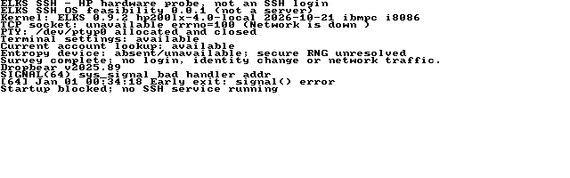

# HP 200LX hardware checkpoint — 2026-11-04

Testing uses the physical HP 200LX made available by the owner on the
BH00K9NP serial adapter at 9600 baud, 8N1. The PPC is reserved for the owner's
PicoMEM work. No PPC access is needed for this checkpoint.

## Observed system

- `uname -a`: `ELKS elks 0.9.2 hp200lx-4.0-local 2026-10-21 ibmpc i8086`.
- `/etc/issue`: `HP 200LX 4 MB lean image / ELKS 0.9.2 / ELKSWeb 0.35dev`.
- Root: MINIX on `/dev/ssd`, 3,072 KiB total, 2,010 KiB free before staging.
- `meminfo`: 498 KiB main-memory pool, about 397 KiB free during the initial
  measurement. This is not an installed-RAM measurement.
- The firmware battery utility reports external power. Its cache age is unknown.
- `ktcp` is stopped. `ifconfig` reports it is not running and `netstat` says the
  network is down. No network configuration was changed.
- `/dev/urandom` and `/dev/random` are absent. Device nodes named `ttyS0` through
  `ttyS3` do not establish that four physical serial ports exist.

This boot differs from the earlier ELKSfetch CF-root test. Its identity and
capabilities are recorded independently rather than assuming that earlier
results apply.

## Physical probe results

The probes were copied into a new `/root/sshprobe` directory using paced
uuencoded serial transfers and verified with `md5sum` on the HP before execution.
They are the same binaries previously checked in QEMU and by the static ISA
scanner; no probe rebuild was needed for this HP boot.

| Check | Result |
| --- | --- |
| OS capability probe | Exit 0; PTY allocation/close, terminal settings and account lookup work |
| TCP capability probe | Network-down error, consistent with stopped `ktcp`; networking not enabled |
| Secure-random path | Absent; no entropy substitute installed |
| 16-bit ABI | `int=2 long=4 pointer=2 longlong=8` |
| SHA-256 known-answer checks | Three passed |
| ChaCha20 known-answer/round-trip checks | Two passed |
| X25519 public/shared/low-order checks | Five passed |
| Crypto process | `RESULT PASS failures=0`, exit 0 |
| Crypto batch duration | Guest-reported 1,159 seconds (19 minutes 19 seconds) |

The first X25519 result arrived after roughly five minutes of host observation.
The complete batch includes five scalar multiplications and the symmetric/hash
checks; it is not an SSH handshake or an isolated per-operation benchmark.
Low-order testing verifies the primitive's all-zero result, which the SSH caller
must reject. No secret keys were generated and no network traffic was needed.

This establishes execution of these probes on this HP configuration. It does
not establish every ELKS platform, original 8086/8088 execution, a full SSH
login, key isolation or constant-time cryptography.

## Full-daemon startup blocker

The exact normal daemon was transferred as `/root/sshprobe/sshdcheck` and
checksum-verified. `sshdcheck -V` prints `Dropbear v2025.89` and exits 0.
`sshdcheck -F` exits 1 with `Early exit: signal() error`. It fails during signal
setup, before the secure-randomness check, host-key loading or listener setup.
Therefore the hardware run does **not** validate the expected RNG refusal seen
in QEMU. No listening service was installed or started.

A focused registration-only probe then tested SIGINT, SIGTERM, SIGPIPE, SIGCHLD
and SIGSEGV, using both ignore dispositions and custom handlers, restoring each
afterward. Both small- and medium-model binaries passed all registrations in
QEMU and on the HP. They send no signals and do not validate delivery, signal
frames or child-reaping behavior. The full daemon's failure is unresolved;
these results rule out simply claiming that the HP lacks the signal interface.
The actual console capture additionally shows `sys_signal bad handler addr`: the
kernel rejects the full daemon's callback address. Callback placement and
address validation are therefore specific leads, not yet a proven root cause.
Full-binary initialization, layout and the exact kernel/libc combination need
further diagnosis. No error check was bypassed and no kernel/libc change was made.

Afterward the shell remained usable, no daemon remained in `ps`, and `meminfo`
again reported approximately 397 KiB free main memory. The test files are left
under `/root/sshprobe`; `/bin`, boot files and network settings were not replaced.

## Linked daemon audit

The normal daemon from the preceding QEMU checkpoint, SHA-256
`7c6d98b80aeb2495bcc4ba18ac92267f2c460d5dd6d09483a802cfc8610293d7`, now
passes the static original-8086/no-x87 instruction gate. Retaining its ELF on
relink did not change the executable hash. The audit covers 52,816 bytes of
near code and 26,656 bytes of far code, with no uncovered bytes or unresolved
decoding ambiguities. Near data/BSS/heap/stack reserve totals 42,272 bytes before
arguments and environment; this is a reservation calculation, not a peak bound.

The audit now compares both `.text` and `.fartext` against the converted ELKS
executable and rejects unknown executable-section mappings. Regression checks
reject changed near/far code bytes, missing far-code length and truncated payload
or supplemental header. `objdump -D` is required because the linked libc has a
relocation symbol within a far-jump operand; `-d` incorrectly splits that
instruction into undecodable pieces at the symbol boundary.

Static coverage is not proof of all execution paths, platform correctness,
constant-time behavior or hardware performance. HP testing does not establish
execution on an original 8086/8088 machine. The test-only QEMU entropy variant
is a different binary and is not covered by this normal-daemon hash.

## Remaining SSH prerequisites

Hardware SSH login still needs resolution of the full-daemon signal failure,
practical crypto performance, a qualified fresh entropy source and a network
or other protected client transport. The console currently occupies the serial
connection. A QEMU-only entropy adapter must not be installed here. A static
seed file is not a substitute, and no weak RNG or authentication bypass is used.

## Performance follow-up

The inherited field multiplication uses 64-bit limb arithmetic and the compiled
probe calls `__muldi3` inside its multiplication loop. This is a candidate
bottleneck, not a measured attribution from a profiler. The probe uses the
small memory model; the daemon uses the medium model, so probe duration must
not be substituted for a measured daemon handshake. Before changing the
backend, compare an established implementation designed for smaller arithmetic
words, preserve known-answer and low-order rejection tests, and check generated
instructions, timing behavior, memory and licensing.

For a comparative probe, BearSSL documents a specialised Curve25519 `m15`
implementation using 13-bit words and a generic `i15` variant. Those are research
candidates, not selected or ported code, and their performance on the HP is
unknown. See the project's [change log](https://bearssl.org/changelog.html) and
[big-integer design](https://bearssl.org/bigint.html). Replacing X25519 alone would
not establish acceptable Ed25519 signing or verification performance.

The current source sets `AUTH_TIMEOUT` to 300 seconds. X25519 key exchange
computes both an ephemeral public key and a shared secret; signature work is
additional. Minutes per scalar multiplication therefore threaten the existing
authentication deadline. This is a feasibility concern inferred from the probe
and source, not a measured HP SSH handshake. No timeout was relaxed to obtain
a demonstration.

## Capture and retained evidence



The existing ELXcap utility captured the HP's logical text console after the
OS probe, version query and failed daemon startup. The kernel callback-address
diagnostic is visible above the daemon error. This is not an SSH session or a
photograph of the LCD. The [original 640x200 one-bit BMP](screenshots/hp200lx-probe.bmp)
was downloaded over serial and checksum-verified; PNG is a lossless format
conversion, without edited content. HP file timestamps show its unset epoch;
the test date above comes from the host session. No clock setting was changed.

- [Hardware results](evidence/20261104-hp200lx/result.json),
  [serial transcript](evidence/20261104-hp200lx/serial.txt),
  [crypto output](evidence/20261104-hp200lx/crypto-output.txt).
- [Normal-daemon audit](evidence/20261104-hp200lx/daemon-audit.json),
  [audit regression checks](evidence/20261104-hp200lx/audit-tests.txt),
  [artifact hashes](evidence/20261104-hp200lx/artifacts.json).
- [QEMU signal-registration comparison](evidence/20261104-hp200lx/qemu-signals/result.json).

The small signal probe lives in `feasibility/src/sigprobe.c`. Reproduce each
model with the prepared toolchain and ELF-retention wrapper described in
[BUILDING](BUILDING.md), substituting `small` or `medium`:

```sh
ia16-elf-gcc -mcmodel=small -melks-libc -march=i8086 -mtune=i8086 \
    -Os -Wall -maout-heap=2048 -maout-stack=2048 \
    -Wl,-Map,sig-small.map feasibility/src/sigprobe.c -o sig-small
ia16-elf-objdump -D -z --insn-width=16 -M intel,i8086 sig-small.elf > sig-small.dis
python3 feasibility/tools/isa-audit.py sig-small sig-small.elf sig-small.dis \
    --map sig-small.map --output sig-small-audit.json
```

Place the resulting `sig-small` and `sig-medium` binaries in a test build
directory and run:

```sh
python3 feasibility/tests/qemu_signal.py --image /path/to/hd32-fat.img \
    --build /path/to/test-build --out /path/to/results
```

It uses a disposable copy,
no network devices or physical serial access, and checks that the input image
remains unchanged.
