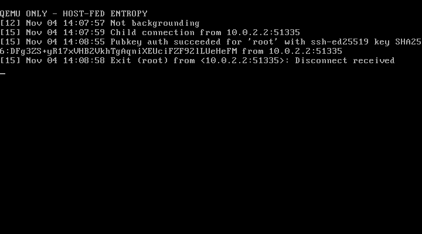

# Public-key login checkpoint — 2026-11-04

The continuation of **ghaerr/ssh-daemon-elks** now completes public-key login
and remote commands from OpenSSH 10.3p1 in disposable ELKS QEMU guests.
Strict verification uses a pre-pinned Ed25519 host key. Negotiation selects
`curve25519-sha256`, `ssh-ed25519` and `chacha20-poly1305@openssh.com` without
legacy algorithm overrides. This remains a development prototype, not a release
candidate: session entropy comes from the trusted test host, and production
entropy and original 8086/8088 execution are unvalidated.

## What changed

- Use an isolated MINIX v1 filesystem with 14-character names, made with
  upstream `mfs`, `setboot` and `Make.devices`. The existing ELKS kernel and
  user binaries are copied unchanged from the FAT fixture. This supplies real
  ownership/mode checks; the earlier FAT fixture could not authenticate safely.
- Call the ELKS public-key list `authkeys`, since `authorized_keys` exceeds that
  filesystem's filename limit. The non-ELKS default remains `authorized_keys`.
  The test uses `/root/authkeys` and `-D /root`, with directory mode 0700 and
  key-file mode 0600. The opened file must be regular, owned by root/the user,
  and not group/other writable, in addition to the existing directory checks.
- Keep a channel open when an empty nonblocking pipe returns `EAGAIN` during
  normal operation. The inherited code treated that as EOF and could truncate
  delayed command output. A 10 ms idle wait prevents empty pipes from spinning
  the event loop; partial packet reads can incur that additional poll interval.
- Retain the preauthentication slot until its child-status pipe actually closes.
  ELKS pipes have no `select` hook and can appear ready while empty. The ELKS
  listener polls these nonblocking pipes and allows one unauthenticated handshake
  at a time. This is **not** a cap on all authenticated sessions or a complete
  resource-exhaustion defense.
- Reserve 16 KiB heap for server builds, retaining the client's 8 KiB heap and
  the 8 KiB stack reservation. Both overrides remain available in `Makefile.elks`.

These adaptations use existing APIs from ELKS
`e1469b64c5809c44d5c822eaeebd0e97d5996289`. No kernel, libc or architecture changes
were made. In that source tree, `elks/fs/pipe.c` and `elks/fs/select.c` explain the
readiness behavior. No physical serial adapters, PPC or HP 200LX were accessed.

## Validation

| Check | QEMU CPU model | Result |
| --- | --- | --- |
| Public-key login, exact delayed command output, child cleanup | 486 | Pass |
| Login and delayed output | Pentium | Pass |
| Unknown client key and incorrect pinned host key | Pentium | Rejected |
| Group/other writable key directory and key file | Pentium | Rejected |
| 16,144-byte payload followed by a delayed marker | Pentium | Exact output received |
| Repeat login and remote exit status 7 | Pentium | Pass |
| Second connection while one unauthenticated slot is held | Pentium | Closed without SSH banner |
| Connection child reaped after each positive/negative case | Pentium | Pass |
| Short or absent entropy response | 486 | Startup refused |
| Normal server/client without a usable random device | 486 | Startup/connection refused |
| 15 wire checks, four independent cipher vectors, two I/O checks, port 65535 | 486 | Pass |
| Ten standalone crypto checks and existing OS probes | 486 | Pass |

Host crypto checks, eleven provenance checks and six instruction-audit tool
regressions also pass. OS probes cover PTY allocation, account lookup, TCP
down/start/stop and a surviving shell; **PTY allocation is not an interactive
SSH shell test**. The regression tools and login suite serve different purposes.

Raw [486 login evidence](evidence/20261104-login/qemu-486/result.json),
[Pentium suite evidence](evidence/20261104-login/qemu-pentium/result.json) and
[normal-build regressions](evidence/20261104-login/regressions/result.json)
include binary hashes. The evidence directories also contain client diagnostics,
exact command output and serial transcripts. Fresh private keys, entropy bytes,
guest images and credentials are not published. Input image hashes remained
unchanged; ephemeral working images and keys were destroyed after each run.

## Memory observations and limits

Server `ps` samples reached a heap break of **13,154 bytes** above the end of
static data. The sampled gap between saved stack pointer and heap break remained
about **6.6 KiB**. Raw per-case samples are in each login run's `memory.json`.

These fields come from ELKS `elkscmd/sys_utils/ps.c`: `HEAP` is
`t_endbrk - t_enddata`, and `FREE` is `t_regs.sp - t_endbrk`. They are not live
allocation counts or a true stack/heap high-water bound. `SIZE` combines code
and data segment sizes; summing process rows would not establish whole-system
peak usage because code may be shared. Samples can miss transient peaks.
The lack of a stack diagnostic is not proof that the stack is bounded.

All emulator tests use QEMU 11.1.0 with TCG and `one-insn-per-tb=on`. Host elapsed
times include emulation, polling and instrumentation; they are not estimates of
8086/8088 handshake performance.

## Reproduction and remaining gates

See [BUILDING](BUILDING.md#disposable-minix-login-fixture) for the remote build
workflow, host image tools and suite commands. [Fixture provenance](evidence/20261104-login/fixture.json)
records the original FAT image, MINIX fixture, boot block and device-manifest
hashes. The OS is not rebuilt by the conversion script. Build logs retain
compiler diagnostics, with private local paths redacted.

Next validation covers interactive PTY sessions, client stdin/EOF, abrupt
authenticated disconnects, rekeying, malformed packets and resource pressure.
The single-user/root configuration does not establish multiuser account
isolation. SFTP and a native key-generation utility remain planned. The linked
daemon still needs its own 8086 ISA audit and whole-session memory analysis,
followed by scheduled physical-machine testing.

The [entropy strategy](ENTROPY.md) keeps fresh external entropy as the development
path. A validated hardware RNG through an existing ELKS interface is the preferred
independent deployment direction; a persistent-state software-only mode remains
separate feasibility work. The normal server still refuses to operate without
its strong source. The QEMU adapter is not suitable for a physical serial link.
No release or invitation to ghaerr has been made.
