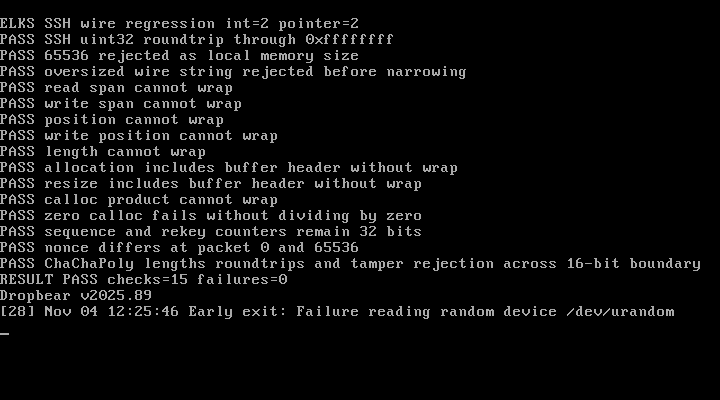

# Server development checkpoint — 2026-11-04

The first ELKS server executable now compiles and links against the existing
prepared ELKS toolchain. This is not a working SSH login service or a release
candidate. The client and server remain experimental.

## Corrections

- SSH channel identifiers and peer windows now retain all 32 wire bits. The
  checked 16-bit reader remains in use for local memory sizes. A 2 MiB peer
  window does not imply a 2 MiB allocation; local receive windows are capped at
  4096 bytes and outgoing packet sizes at the configured 2048 bytes.
- Packet sequence numbers, cipher callbacks, MAC input and rekey byte counters
  are 32 bits. The inherited 16-bit sequence storage could repeat a ChaCha20
  nonce after 65,536 packets under the same key. The inherited byte counters
  could also wrap before reaching the rekey threshold.
- Buffer span checks use subtraction after validating the current position.
  Allocation checks include the buffer header; calloc rejects overflowing
  products and zero element counts. Packet overhead is checked without 16-bit
  addition overflow.
- The client host-key parser uses the actual key-type enum. Truncation,
  incompatible-pointer and implicit-function-declaration warnings now fail the
  ELKS build. Other recorded warnings remain for review.

The protocol widths follow [RFC 4254](https://www.rfc-editor.org/rfc/rfc4254.html#section-5)
and the sequence-based nonce construction follows
[OpenSSH's ChaCha20-Poly1305 specification](https://github.com/openssh/openssh-portable/blob/V_9_9_P2/PROTOCOL.chacha20poly1305).
These corrections are not a complete audit of 16-bit assumptions or current
upstream security fixes.

## Server adaptation

Client and server compile into separate object directories. The server includes
Dropbear's forwarding-denial handler even though forwarding is disabled. DH
bignum operations are excluded when only Curve25519 is enabled, and SIGTTOU is
used only on platforms that define it.

ELKS's existing `usleep()` supplies the failed-authentication delay, rounded up
and restarted on interruption. The single-user configuration rejects a requested
UID or GID differing from the process identity, avoiding a fictitious successful
`initgroups()` implementation. Public-key authentication is still required;
password authentication and multiuser switching remain disabled. These login
paths have not yet been exercised in a real SSH session.

Startup requires secure randomness before hostkey loading or listening. See
[the entropy investigation](ENTROPY.md) for the unresolved provisioning choices.

## Regression coverage and limits

The `wiretest` executable uses the production buffer, allocator, ChaCha20 and
Poly1305 sources. Fifteen checks cover full-width wire integers, rejection of
oversized local lengths, buffer/allocator overflow, sequence/rekey storage,
nonce separation at 65,536, cipher length decoding, roundtrips and tampered tags.
Four complete ciphertext/tag fixtures at sequences 0, 65535, 65536 and
4294967295 were generated independently with Python cryptography 50.0.2; the
script and public fixtures are in `tests/`.

The unit harness intercepts fatal exits and supplies test-only memory wiping and
comparison helpers. It does not certify production constant-time behavior,
network packet parsing, channel lifecycle, authentication or session isolation.
Only fixed public test keys are used.

Startup tests check the version command and refusal without entropy. They do
not establish a successful handshake, host-key loading, PTY attachment, public-key
login, rekeying or SFTP. Compilation uses `-march=i8086`; the new full client,
server and wire regression executable still need linked-code ISA audits and
original 8086/8088 execution tests. The earlier two small probes' ISA results
do not apply to these binaries.

The 486-model run passed all fifteen wire checks, four independent cipher
vectors, ten crypto checks, server version/refusal, client refusal, PTY/account
probes and TCP down/start/stop. Its [result](evidence/20261104-server/qemu-486.json)
and [serial transcript](evidence/20261104-server/qemu-486.txt) identify the tested
binaries. That run preceded a help-text-only update to display the actual
4096-byte window limit; final build hashes below identify the updated binaries.

The final binaries passed the same suite on QEMU's Pentium model. See the
[result](evidence/20261104-server/qemu-pentium.json) and
[serial transcript](evidence/20261104-server/qemu-pentium.txt). Both runs used
disposable images with restricted networking and no forwarded ports; the
original disk-image hashes were unchanged. The host ten-vector suite,
eleven-file provenance check and six ISA-audit regression tests also pass.

This is an actual QMP console capture from the Pentium run, converted from PPM
to PNG without content editing. For readability, the console rerun filters out
the four long VECTOR lines; the serial transcript retains those checked values.
The final line is the expected startup refusal, not a successful SSH login.

## Build evidence

The final client is 99,736 bytes and server is 107,448 bytes. Their declared
near-data/BSS/heap/stack reservations total 32,768 and 33,968 bytes respectively,
before arguments/environment. These are executable header reservations, not
measured whole-session peaks. The wire regression executable is 32,176 bytes.

[Build summary and hashes](evidence/20261104-server/build.json),
[client compiler log](evidence/20261104-server/dbclient-build.txt) and
[server compiler log](evidence/20261104-server/dropbear-build.txt) retain the
remaining warnings. Absolute toolchain paths in compiler notes are replaced
with `$ELKS` to avoid publishing local account names.

## Next gates

The subsequent [socket and entropy checkpoint](SOCKET-PROGRESS.md) records
application socket fixes, signed-I/O tests and the first network attempt.

1. Review inherited socket shims, including `shutdown()` and `getsockopt()`
   implementations that report success without providing the normal semantics.
2. Validate a fresh entropy provider in an isolated test environment, including
   failure, short-read, disconnect and replay cases.
3. Measure full-process heap/stack usage and adapt packet I/O to ELKS's signed
   16-bit return sizes; successful compilation is not a memory bound.
4. Exercise modern OpenSSH handshake and host verification, then positive and
   negative public-key login, PTY/shell/command cleanup and rekeying.
5. Schedule PPC and HP 200LX tests only after the owner makes them available.
   Invite ghaerr only after the first viable release candidate.
