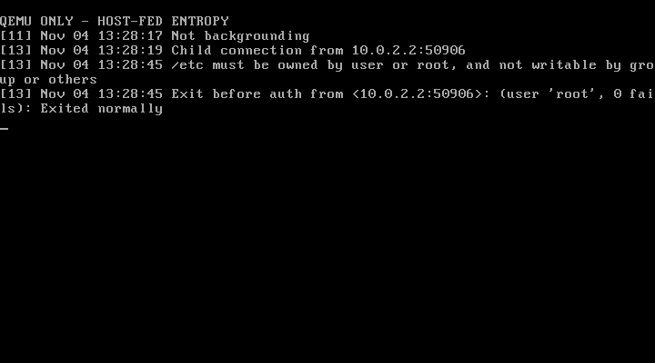

# Socket and SSH transport checkpoint — 2026-11-04

This continues the public fork of ghaerr/ssh-daemon-elks. A QEMU-only build now
completes SSH-2 key exchange with OpenSSH 10.3 and passes strict verification
against a pre-pinned Ed25519 host key. Encrypted authentication messages work.
**Public-key login is still blocked, and this is not a release candidate.**
No ELKS kernel/libc code or physical machines were changed.

## Application changes

- Remove inherited successful no-op `getsockopt()` and `shutdown()` shims.
  The prepared ELKS `connect()` completes synchronously; a negative return is
  failure, not proof of a connection that can be checked with `SO_ERROR`.
- Treat TCP_NODELAY as unavailable instead of assigning another option's number.
  Socket half-close is explicitly unsupported. Forwarding remains disabled;
  enabling a bidirectional channel cannot silently pretend half-close succeeded.
- Limit each `atomicio`, packet read and packet write request to `INT_MAX`, since
  ELKS `ssize_t` is signed 16-bit and `size_t` is unsigned. A partially written
  packet remains queued until its entire buffer has been written.
- Check process errors against `(pid_t)-1`. ELKS's unsigned `pid_t` made the
  inherited `waitpid() > 0` reaping loops spin on errors. Correct both server
  loops and fork/error handling in the compiled client/server paths.
- Format peer ports as unsigned. Port 65535 now survives address conversion.

These changes use existing APIs in ELKS commit
`e1469b64c5809c44d5c822eaeebd0e97d5996289`. They do not establish that all other
socket, signal, process or terminal semantics match Dropbear's expectations.

## Verified regression checks

The final normal client and server compile with the original 8086 target flags.
The [Pentium QEMU result](evidence/20261104-sockets/qemu-pentium.json) and
[serial transcript](evidence/20261104-sockets/qemu-pentium.txt) cover:

- Fifteen wire/buffer checks and four independent cipher vectors.
- Two production `atomicio` checks: an oversized request capped before EOF,
  plus a complete 2048-byte transfer with interruption and partial reads.
- Production `getnameinfo()` formatting of port 65535.
- Ten crypto checks, account lookup, PTY allocation and TCP down/start/stop.
- Normal server version/startup refusal and client refusal without entropy.
- Shell survival and an unchanged original disk image.

The host crypto checks, eleven-file provenance check and six ISA-audit tool
regressions also pass. Full client/server linked-code ISA audits and original
8086/8088 execution remain outstanding. Fork exhaustion, signal interruption,
multiple sessions and authenticated child cleanup still need dedicated tests.

## Test-only entropy and transport

A separate `dropbear-qemu` build uses a private, emulated second serial port to
request fresh entropy from the trusted host OS. Both normal executables are
built without this adapter. See [ENTROPY](ENTROPY.md) for its trust boundaries,
including the absence of transport authentication and replay protection.

The [short-response test](evidence/20261104-sockets/entropy-short.json) exercised
two requests, receiving 16 bytes each, and refused startup. The
[silent-source test](evidence/20261104-sockets/entropy-silent.json) exercised two
requests with no response and refused startup. Neither accepted partial input.
These test the emulator adapter, not a hardware RNG or production provisioning.

With healthy input, OpenSSH 10.3p1 completed banner exchange and negotiated
`curve25519-sha256`, `ssh-ed25519` and `chacha20-poly1305@openssh.com` using its
normal algorithm defaults. Strict host-key verification passed, NEWKEYS was
exchanged, and the encrypted `ssh-userauth` service was accepted. The client
then offered the fresh test public key.

Login was rejected because the FAT image presents `/etc` as group/other-writable.
Dropbear's authorized-keys path checks correctly rejected that directory. No
permission checks or authentication were bypassed. See the
[486 attempt result](evidence/20261104-sockets/ssh-attempt.json),
[OpenSSH log](evidence/20261104-sockets/ssh-client.txt) and
[guest log](evidence/20261104-sockets/ssh-guest.txt). The harness deliberately
reports `status: blocked` and exits nonzero until a remote command succeeds.

The same transport and permission-rejection result passed on the Pentium model;
see its [result](evidence/20261104-sockets/ssh-pentium.json),
[client log](evidence/20261104-sockets/ssh-pentium-client.txt) and
[guest transcript](evidence/20261104-sockets/ssh-pentium-guest.txt).

Actual QMP console capture from the Pentium run, converted from PPM to PNG
without editing the content. It shows the guest daemon log; the linked host
client log records the successful key exchange and strict host verification.
This is not a successful-login screenshot.

This validates transport interoperability for this assisted emulator setup;
it does not validate standalone entropy, successful public-key authentication,
PTY sessions, command execution, SFTP, rekeying or production security. The
client also reports that the selected key exchange is not post-quantum.

## Memory findings

After fixing the reaping loop, the normal 8 KiB heap reservation failed during
key exchange when another 3184-byte allocation was requested. The child exited
and was reaped; the daemon and guest shell survived. See the
[8 KiB result](evidence/20261104-sockets/heap8-attempt.json) and
[guest transcript](evidence/20261104-sockets/heap8-guest.txt).

An explicit QEMU-only 16 KiB heap reservation allowed the transport test above
to complete. The stack reservation remains 8 KiB. Normal builds still default
to 8 KiB heap and refuse startup on this image without secure entropy. These
are link-time reservations, not measured whole-session peaks or a recommended
hardware configuration. No stack-overflow diagnostic appeared, which is not
proof of a safe whole-session stack bound.

## Evidence and next gates

[Build hashes and sizes](evidence/20261104-sockets/build.json),
[server build log](evidence/20261104-sockets/dropbear-build.txt),
[client build log](evidence/20261104-sockets/dbclient-build.txt),
[test-server build log](evidence/20261104-sockets/qemu-build.txt) and
[I/O test build log](evidence/20261104-sockets/iotest-build.txt) identify this
checkpoint. Server/client logs include the initial build followed by incremental
rebuilds of the PID and port fixes. Compiler paths are redacted to `$ELKS`.
No private keys, random bytes or reusable test disk images are published.

Next: prepare a disposable filesystem that enforces authorized-key ownership
and permissions, then test positive and negative public-key authentication,
wrong-host rejection, disconnect handling and repeated connections. Measure
memory/stack and cleanup before PTY commands, rekeying and SFTP. Production
entropy selection and original-CPU testing remain separate gates. Hardware
access and ghaerr's invitation remain deferred as requested.
