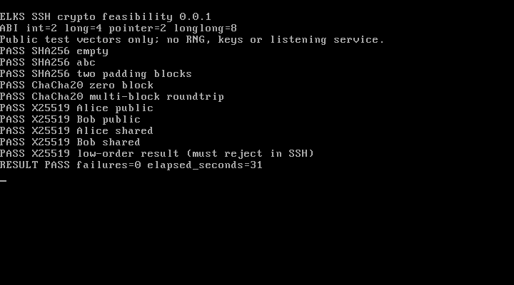

# Initial validation — 2026-11-04

This records the historical probe/client baseline. The latest
[login checkpoint](LOGIN-PROGRESS.md) validates QEMU public-key login with
test-only host entropy. Deployment security remains unverified.

## Completed

- Host: ten crypto checks passed (known answers plus a ChaCha20 roundtrip).
- Provenance: eleven vendored files match recorded upstream SHA-256 hashes.
- ISA-audit regression tests: six passed.
- ELKS: both probes compiled with IA16 GCC 6.3.0, `-march=i8086`, small model.
- Linked-code audit: all executable bytes decoded; no forbidden instruction
  reported in either probe, including linked runtime/library code.
- QEMU 11.1.0: the same binaries passed on the **486 and Pentium** CPU models,
  using unchanged ELKS 0.9.2 kernel `e1469b64` in disposable FAT images.
- Guest checks: 16-bit ABI, all ten crypto checks, PTY allocation, account lookup,
  sockets while the stack is down/up/down, and a surviving shell. Input images
  retained their original hashes; no physical machines were accessed.
- A third run on QEMU's `qemu32` model repeated the probes and verified that
  `dbclient` exits with an error when the random device is unavailable, without
  taking its weak-entropy fallback. This is a failure-path test, not a login.

| Probe | Text bytes | Data + BSS | Heap reservation | Stack reservation |
| --- | ---: | ---: | ---: | ---: |
| `cryptest` | 46,336 | 4,848 | 1,024 | 8,192 |
| `osprobe` | 3,504 | 3,904 | 2,048 | 2,048 |

Reservations are not measurements of peak consumption. Compiler frame reports
show 1,764 bytes for the X25519 function and additional nested frames; full stack
high-water measurement and side-channel review remain pending.

Evidence: [486 result](evidence/20261104/qemu-486.json),
[486 serial log](evidence/20261104/qemu-486.txt),
[Pentium result](evidence/20261104/qemu-pentium.json),
[Pentium serial log](evidence/20261104/qemu-pentium.txt),
[crypto ISA audit](evidence/20261104/cryptest-audit.json),
[OS ISA audit](evidence/20261104/osprobe-audit.json).
Client refusal evidence: [result](evidence/20261104/qemu-client.json) and
[serial log](evidence/20261104/qemu-client.txt).

## Actual emulator capture

This is a QMP screendump from a second execution on the same 486-model guest,
converted from PPM to PNG without editing the content. The serial log records
that console execution. It is not a hardware screenshot or an SSH login.

## Not established

- ELKS daemon build, SSH handshake, authentication, rekeying or SFTP.
- A secure randomness source: the tested image has no usable `/dev/urandom`.
- Original 8086/8088 execution or timing, NEC/other machine compatibility,
  older ELKS versions, or compatibility with future kernel/library changes.
- Constant-time behavior of 64-bit arithmetic on 16-bit hardware.
- Whole-daemon memory/stack bounds or external security review.

The inherited `dbclient` was separately rebuilt with the weak-randomness option
disabled and `-march=i8086`. Compilation succeeded, but this does not certify
its linked ISA, stack budget or secure runtime. Those require separate tests.
The executable is 99,040 bytes. [Build evidence](evidence/20261104/client-build.json)
records its hash and warnings. Integer truncation and an incompatible pointer
warning in particular require investigation before any interoperability claim.

The first client refusal test also reported `STACK USING 660 UNUSED HEAP` with
the inherited 2048-byte stack reservation. The client now reserves 8192 bytes;
the QEMU test explicitly rejects that diagnostic. This change addresses the
observed initialization path, not a measured bound for a full SSH session.
