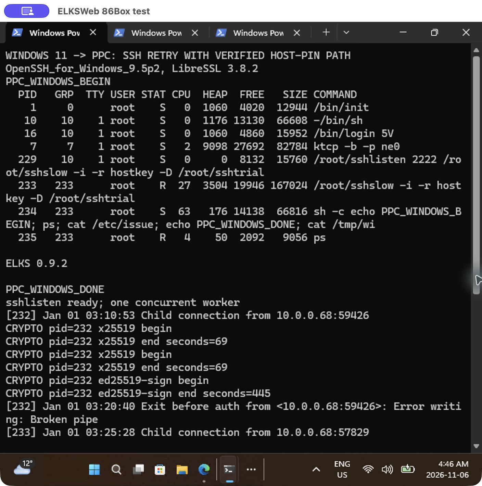
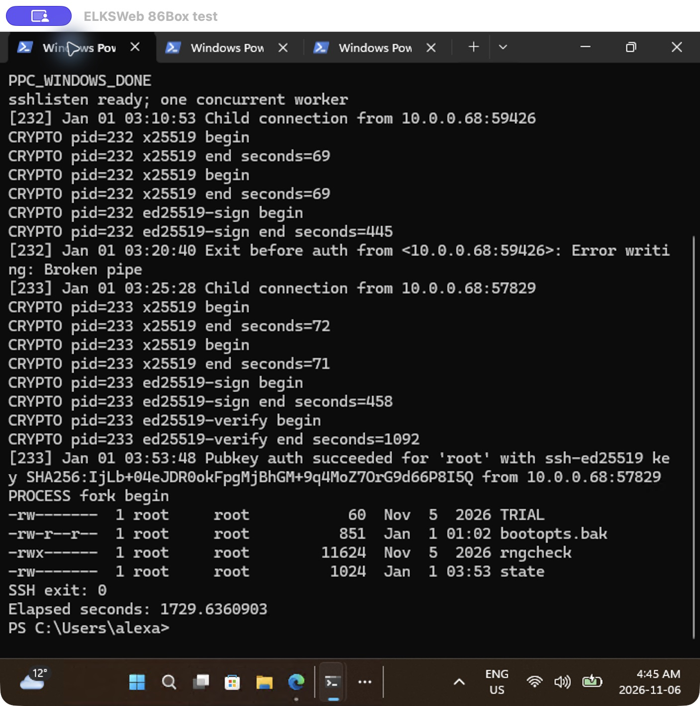

# Windows 11 native SSH client compatibility

Status on 2026-11-06: **one native Windows-to-PPC command session passed,
with native result screenshots captured; broader acceptance matrix pending**. During the
2026-11-04 preflight, native PowerShell 5.1 on the Surface Laptop running in
Windows Terminal reported:

| Item | Observed value |
| --- | --- |
| OS | Microsoft Windows 11 Pro, 10.0.26300, build 26300, 64-bit |
| Executable | `C:\Windows\System32\OpenSSH\ssh.exe` |
| Client | `OpenSSH_for_Windows_9.5p2, LibreSSL 3.8.2` |
| `ssh -Q kex` match | `curve25519-sha256` |
| `ssh -Q key` match | `ssh-ed25519` |
| `ssh -Q cipher` match | `chacha20-poly1305@openssh.com` |


Actual Windows Terminal pixels captured through Windows App on macOS. The
screen explicitly identifies this as preflight, with no PPC login. RDP became
responsive after the owner reported disabling clipboard redirection. That is
an observed recovery, not a controlled diagnosis of the earlier connection
stall. No SSH configuration or installed software was changed.

Those preflight algorithm matches alone establish compiled support. The
physical test below now also establishes negotiation and authenticated remote
commands for this client. The isolated Windows-to-QEMU route and broader
Windows acceptance matrix remain pending.

## First physical PPC command session — 2026-11-05

Native `C:\Windows\System32\OpenSSH\ssh.exe` on surfacelaptop, reporting
`OpenSSH_for_Windows_9.5p2, LibreSSL 3.8.2`, connected over Ethernet to
`10.0.0.66:2222`. It verified the existing pinned Ed25519 host key,
authenticated with a newly authorized dedicated Windows Ed25519 identity and
executed `ps` and `cat /etc/issue`. Both command markers returned, the issue
reported `ELKS 0.9.2`, and the client diagnostic log reports remote exit status
zero. No legacy algorithm overrides or runtime entropy helper were used.

Negotiated algorithms were `curve25519-sha256`, `ssh-ed25519` and
`chacha20-poly1305@openssh.com` in both directions. The private Windows key
stayed on the Surface. Only its public key was transferred for authorization;
the existing Mac test identity remains authorized too.

| Successful worker operation | PPC seconds |
| --- | ---: |
| First X25519 | 72 |
| Second X25519 | 71 |
| Ed25519 host signing | 458 |
| Ed25519 client verification | 1092 |

These stages total **28 minutes 13 seconds** and exclude connection setup and
commands. The completed native Windows UI was captured after unlocking the Mac
on 2026-11-06: **1729.6360903 seconds (28m49.6s), native process exit code 0**.
The screenshots show the original session scrollback, without rerunning SSH or
replaying saved logs. The public client/command logs had already been collected
automatically when the test finished.
The log's separate "Transferred ... in 14.5 seconds" line is not the full
authentication time. The earlier OS-build preflight has not been re-read in
this run. This is a feasibility result, not practical login performance or a
completed Windows terminal/PTY matrix.

The server was the qualified `edcompact-slow` worker, SHA-256
`a0dbcbbbb8608a7020bdcb6613eb8b19b5e7cda79fd62205a49862f9788182b8`,
with the original single-worker launcher, SHA-256
`7cf7004f79fb34d78fcae7672a688428bd7ac2fa6a7416c1d5ccb599ab8ad49c`.
Its explicit diagnostic authentication limit was 1800 seconds, with a Windows
watchdog limiting the client to 1860 seconds. The newer listener correction
and field-optimization candidate were not used in this physical test.

The first Windows attempt reached the host-key reply but failed closed because
PowerShell passed the literal `$kh` as the known-hosts filename. The actual
returned fingerprint matched the saved PPC pin. The retry built the option as
a separate string and checked its resolution using `ssh -G` before connecting:

```powershell
$khArg = 'UserKnownHostsFile=' + $kh
& $sshClient -G -F NUL -o $khArg root@10.0.0.66 |
    Select-String userknownhostsfile
# The actual connection also uses: -oStrictHostKeyChecking=yes -o $khArg
```

The server log retains the first attempt's broken-pipe disconnect and the
subsequent successful authentication. No out-of-memory error was reported.
The command output shows a 167,024-byte SSH worker and 66,816-byte command
shell; these are process observations, not a peak-memory bound.
Follow-up on 2026-11-06 confirmed a cleanup defect: the exited worker (PID
233) remained a zombie while listener 229 was idle. The prior command-name
check could not see it because ELKS omits zombie command names. After the owner
released competing serial bridges and restarted getty, serial maintenance
worked. Stopping listener 229 removed both entries; original startup was not
changed. See [the listener correction and regression](LISTENER-SHUTDOWN.md).
The authenticated commands and native exit zero passed, but idle child cleanup
did not pass for this recorded binary pair.





These are unmodified Windows App captures of Windows Terminal. The lower
server log retains the failed first attempt (PID 232) as well as the successful
retry (PID 233); the earlier broken pipe is not the outcome of the retry.
Screenshot hashes and provenance are in the result record below.

Evidence: [result](evidence/20261105-windows-ppc/result.json),
[client diagnostics](evidence/20261105-windows-ppc/client.txt),
[commands and server timing log](evidence/20261105-windows-ppc/command.txt),
[first attempt](evidence/20261105-windows-ppc/first-result.json), and
[first-attempt diagnostics](evidence/20261105-windows-ppc/first-client.txt).

Test the Windows-provided `ssh.exe` first. A separately installed Win32-OpenSSH
build is a separate matrix entry. WSL OpenSSH does not validate the native
Windows executable or its terminal integration.

## Record the actual client

Run these read-only commands in native PowerShell on the test machine:

```powershell
Get-CimInstance Win32_OperatingSystem |
    Select-Object Caption, Version, BuildNumber, OSArchitecture
Get-Command ssh.exe -All | Select-Object Source, Version
$ElksSshClient = Join-Path $env:WINDIR 'System32\OpenSSH\ssh.exe'
Test-Path $ElksSshClient
& $ElksSshClient -V
& $ElksSshClient -Q kex
& $ElksSshClient -Q key
& $ElksSshClient -Q cipher
```

If the expected executable is absent, record that before choosing an installation
method. The commands above do not install anything or modify SSH configuration.
Algorithm listings show compiled support, not proof that local policy permits
negotiation. Also record whether the session runs in Windows Terminal or the
legacy console, and which shell launches the client.

The currently validated ELKS negotiation uses `curve25519-sha256`,
`ssh-ed25519` and `chacha20-poly1305@openssh.com`. Start with default algorithm
selection and strict host checking; do not enable SSH-1, SHA-1 host signatures
or other legacy overrides to obtain a pass. Record actual negotiated algorithms
from verbose client diagnostics.

## Isolated fixture and credentials

Use the same disposable MINIX guest described in [BUILDING](BUILDING.md), with
the QEMU-only entropy adapter. Keep its forward bound to loopback. To reach it
from another computer, arrange a trusted tunnel rather than turning the
prototype into a LAN/public service. The current Python harness runs the client
locally; external-client orchestration still needs to be added once command
access and the test route are working.

Generate a fresh test identity, place its public key in the fixture's
`/root/authkeys`, and pin the guest host public key before connecting. Use a
dedicated client configuration and known-hosts file, not the user's normal SSH
identity or agent. Windows private-key ACL handling is part of this test.
Destroy temporary private keys and guest copies afterwards; retain only logs,
public fingerprints and results. No physical PPC/HP 200LX is needed.

## Acceptance matrix

| Check | Current Windows status |
| --- | --- |
| Default algorithm negotiation and strict pinned host verification | Pass for the recorded PPC session |
| Ed25519 public-key login, delayed output and repeat login | One PPC login and delayed output pass; repeat Windows login pending |
| Full 16,144-byte payload and nonzero remote exit status | Pending |
| Incorrect host/client key and unsafe server key permissions rejected | Pending |
| Windows input, redirected stdin/EOF and output line endings | Pending |
| Interactive PTY, Enter, Backspace, Ctrl-C, resize and terminal rendering | Pending |
| Rekeying, abrupt disconnect and server child cleanup | Pending |

The first four rows extend the existing QEMU checks to a different client. The
[macOS session checkpoint](SESSION-PROGRESS.md) now covers redirected stdin/EOF,
automated PTY commands and forced rekeying; full terminal interaction and abrupt
disconnect handling still need validation. Terminal behavior must be assessed separately from
transport/authentication. SFTP, `scp` and WinSCP are outside this checkpoint;
the ELKS SFTP subsystem is not implemented.

A passing report must name the Windows build/architecture, exact executable and
client version, terminal, ELKS baseline, server binary hash, entropy mode and
tested cases. One client version does not certify every Windows 11 build or
enterprise policy configuration.

## References

- [Microsoft: SSH in Windows Terminal](https://learn.microsoft.com/en-us/windows/terminal/tutorials/ssh)
- [Microsoft: OpenSSH installation and first use](https://learn.microsoft.com/en-us/windows-server/administration/openssh/openssh_install_firstuse?pivots=windows-11&tabs=powershell)
- [Current QEMU login evidence](LOGIN-PROGRESS.md)
