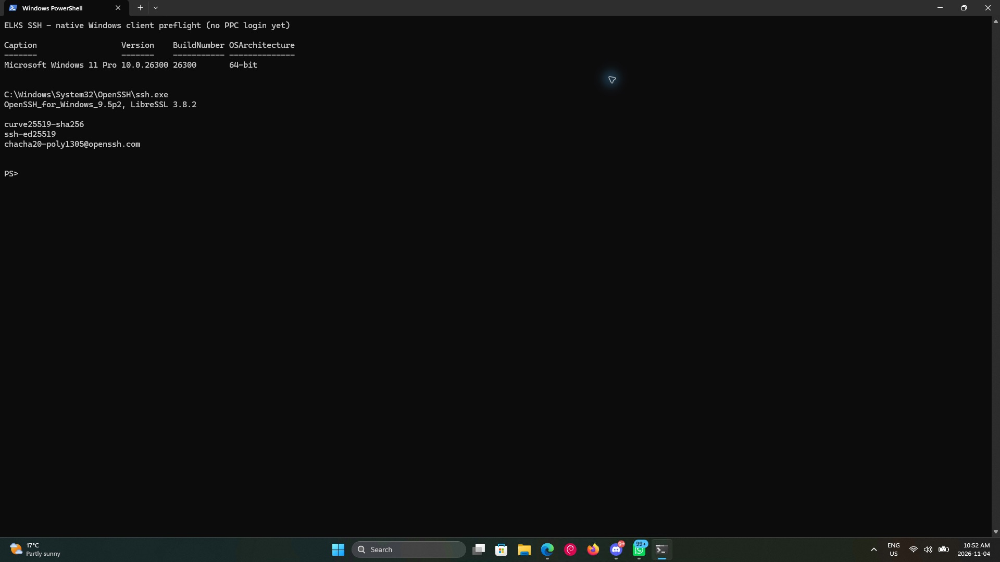

# Windows 11 native SSH client compatibility

Status on 2026-11-04: **native client preflight completed; ELKS connection
matrix still pending**. On the Surface Laptop, native PowerShell 5.1 running in
Windows Terminal reported:

| Item | Observed value |
| --- | --- |
| OS | Microsoft Windows 11 Pro, 10.0.26300, build 26300, 64-bit |
| Executable | `C:\Windows\System32\OpenSSH\ssh.exe` |
| Client | `OpenSSH_for_Windows_9.5p2, LibreSSL 3.8.2` |
| `ssh -Q kex` match | `curve25519-sha256` |
| `ssh -Q key` match | `ssh-ed25519` |
| `ssh -Q cipher` match | `chacha20-poly1305@openssh.com` |



Actual Windows Terminal pixels captured through Windows App on macOS. The
screen explicitly identifies this as preflight, with no PPC login. RDP became
responsive after the owner reported disabling clipboard redirection. That is
an observed recovery, not a controlled diagnosis of the earlier connection
stall. No SSH configuration or installed software was changed.

The algorithm matches establish compiled support, not negotiated compatibility.
Existing successful ELKS connections use macOS OpenSSH 10.3p1 against QEMU.
The isolated Windows-to-QEMU route and Windows acceptance matrix remain pending.

Test the Windows-provided `ssh.exe` first. A separately installed Win32-OpenSSH
build is a separate matrix entry. WSL OpenSSH does not validate the native
Windows executable or its terminal integration.

## Record the actual client

Run these read-only commands in native PowerShell on the test machine:

```powershell
Get-CimInstance Win32_OperatingSystem |
    Select-Object Caption, Version, BuildNumber, OSArchitecture
Get-Command ssh.exe -All | Select-Object Source, Version
$ElksSshClient = Join-Path $env:WINDIR 'System32\OpenSSH\ssh.exe'
Test-Path $ElksSshClient
& $ElksSshClient -V
& $ElksSshClient -Q kex
& $ElksSshClient -Q key
& $ElksSshClient -Q cipher
```

If the expected executable is absent, record that before choosing an installation
method. The commands above do not install anything or modify SSH configuration.
Algorithm listings show compiled support, not proof that local policy permits
negotiation. Also record whether the session runs in Windows Terminal or the
legacy console, and which shell launches the client.

The currently validated ELKS negotiation uses `curve25519-sha256`,
`ssh-ed25519` and `chacha20-poly1305@openssh.com`. Start with default algorithm
selection and strict host checking; do not enable SSH-1, SHA-1 host signatures
or other legacy overrides to obtain a pass. Record actual negotiated algorithms
from verbose client diagnostics.

## Isolated fixture and credentials

Use the same disposable MINIX guest described in [BUILDING](BUILDING.md), with
the QEMU-only entropy adapter. Keep its forward bound to loopback. To reach it
from another computer, arrange a trusted tunnel rather than turning the
prototype into a LAN/public service. The current Python harness runs the client
locally; external-client orchestration still needs to be added once command
access and the test route are working.

Generate a fresh test identity, place its public key in the fixture's
`/root/authkeys`, and pin the guest host public key before connecting. Use a
dedicated client configuration and known-hosts file, not the user's normal SSH
identity or agent. Windows private-key ACL handling is part of this test.
Destroy temporary private keys and guest copies afterwards; retain only logs,
public fingerprints and results. No physical PPC/HP 200LX is needed.

## Acceptance matrix

| Check | Current Windows status |
| --- | --- |
| Default algorithm negotiation and strict pinned host verification | Pending |
| Ed25519 public-key login, delayed output and repeat login | Pending |
| Full 16,144-byte payload and nonzero remote exit status | Pending |
| Incorrect host/client key and unsafe server key permissions rejected | Pending |
| Windows input, redirected stdin/EOF and output line endings | Pending |
| Interactive PTY, Enter, Backspace, Ctrl-C, resize and terminal rendering | Pending |
| Rekeying, abrupt disconnect and server child cleanup | Pending |

The first four rows extend the existing QEMU checks to a different client. The
[macOS session checkpoint](SESSION-PROGRESS.md) now covers redirected stdin/EOF,
automated PTY commands and forced rekeying; full terminal interaction and abrupt
disconnect handling still need validation. Terminal behavior must be assessed separately from
transport/authentication. SFTP, `scp` and WinSCP are outside this checkpoint;
the ELKS SFTP subsystem is not implemented.

A passing report must name the Windows build/architecture, exact executable and
client version, terminal, ELKS baseline, server binary hash, entropy mode and
tested cases. One client version does not certify every Windows 11 build or
enterprise policy configuration.

## References

- [Microsoft: SSH in Windows Terminal](https://learn.microsoft.com/en-us/windows/terminal/tutorials/ssh)
- [Microsoft: OpenSSH installation and first use](https://learn.microsoft.com/en-us/windows-server/administration/openssh/openssh_install_firstuse?pivots=windows-11&tabs=powershell)
- [Current QEMU login evidence](LOGIN-PROGRESS.md)
