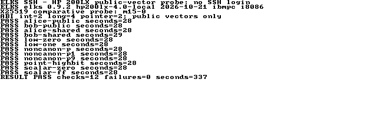

# X25519 comparison — 2026-11-04

This is an isolated public-vector experiment. The daemon remains the inherited
Dropbear implementation; no production crypto, kernel or libc was replaced.
The purpose is to test whether an established implementation using smaller
arithmetic words can improve the HP's slow scalar multiplication.

## Candidates and provenance

The baseline is the already pinned Dropbear/TweetNaCl source. The candidates
use unchanged BearSSL 0.6 `ec_c25519_m15.c` with either `BR_SLOW_MUL15=0`
(unrolled multiplication) or `BR_SLOW_MUL15=1` (Karatsuba multiplication).
BearSSL describes its specialised Curve25519 implementation as using 13-bit
words in the [official changelog](https://bearssl.org/changelog.html).
The [vendor manifest](../feasibility/vendor/manifest.json) pins the official
release archive and every copied source/header. These probe files retain their
upstream licenses. BearSSL's other algorithms and TLS implementation are not
linked into this experiment.

Both variants use upstream `BR_NO_ARITH_SHIFT=1`; `BR_CT_MUL15` remains at its
default zero. No arithmetic formula was rewritten. All three probes use the
same medium-model harness, 8 KiB stack reservation and 1 KiB heap reservation,
with IA16 GCC 6.3.0 and `-march=i8086 -mtune=i8086 -Os -fwrapv`.
The prepared ELKS tree is `e1469b64c5809c44d5c822eaeebd0e97d5996289`.

## Tests and interpretation

The suite includes four [RFC 7748](https://www.rfc-editor.org/rfc/rfc7748.html#section-6.1)
public/shared-secret vectors, low-order zero
and one, noncanonical p and p+1, p+9, the ignored point high bit, and zero/all-one
scalar encodings. The host reference generator checks the RFC outputs and
produces the remaining expected values with Python `cryptography`.

All three variants pass these 12 cases on the Mac under AddressSanitizer and
UndefinedBehaviorSanitizer. A separate host differential test passes 768
comparisons: 256 deterministic public input pairs against three C backends,
including scalar-clamping and point-high-bit equivalence. These are host tests;
they do not establish 16-bit correctness.

The unrolled variant passes all 12 cases in the actual 16-bit QEMU build.
The Karatsuba variant fails all 12 cases in that build (475 seconds total)
and is excluded from hardware testing.
The cause is unresolved; host success and an ISA audit cannot override failed
target vectors. Do not select that variant for an SSH build.

Low-order tests check the primitive's all-zero result. BearSSL's primitive does
not itself reject that result. Any eventual SSH integration must retain
Dropbear's constant-time all-zero rejection in `src/kex-x25519.c`.

## Size and timing

| Probe | File bytes | Near code | Far code | QEMU Alice vector |
| --- | ---: | ---: | ---: | ---: |
| Dropbear baseline | 9,152 | 4,576 | 2,368 | 7 s, pass |
| BearSSL unrolled | 43,384 | 39,184 | 2,048 | 1 s, pass |
| BearSSL Karatsuba | 19,896 | 15,680 | 2,048 | 38 s, fail |

These QEMU figures are integer guest seconds on the disposable 486 fixture,
not hardware timings or precise speed ratios. The unrolled 12-case QEMU batch
takes 13 seconds. The original fixture image is not changed and no NIC is
attached. The earlier 19-minute HP crypto batch uses a small-model build with
additional primitives, so it is not a matched baseline for this experiment.

All three linked probes pass the static original-8086/no-x87 audit. The failing
Karatsuba result illustrates why instruction compatibility alone is insufficient.
Near data/BSS/heap/stack reservations total 13,952 bytes for the baseline and
13,904 for each candidate, before arguments and environment. These reservations
are not measured peak memory. Compiler stack reports are per-function estimates,
not whole-call-chain bounds. `api_mul` reports 1,300 bytes in both candidates;
the Karatsuba `mul20` adds a 1,070-byte frame.

The matched HP quick test passes on both binaries: the baseline Alice vector
takes 235 guest seconds and the unrolled candidate takes 28 (29 including
harness/output overhead). This single-vector comparison is approximately 8.4×
faster; it is not a full SSH timing or a statistical benchmark.

The same unrolled executable then passes all 12 vectors on the physical HP in
337 seconds (5 minutes 37 seconds), exit 0. Individual operations take 28–29
seconds. Afterwards `ps` shows no remaining probe and `meminfo` reports about
397 KiB free main memory. This is cleanup evidence, not a peak-memory bound.
Only public probes under `/root/sshprobe` were used; no service was installed.



Actual ELXcap capture of the completed probe's saved output displayed on the
HP console. The [original BMP](screenshots/hp200lx-x25519.bmp) was downloaded
over serial and MD5-verified (`adcc246c6e08401c67feca81de3dbcac`); PNG is a
lossless format conversion. The heading identifies this as a public-vector
probe, not an SSH login. No output text was edited into the image.

## Selection gates

The unrolled probe is promising but substantially larger. Existing Ed25519
signing and verification still use the baseline arithmetic, so replacing only
X25519 neither removes all that code nor establishes a practical SSH handshake.
Measure the linked daemon's segments, stack and complete login before selecting
a backend; the normal daemon is unchanged at this checkpoint.

The generated candidate code uses 16-bit multiply instructions. No constant-time
claim has been established for original 8086/8088, the HP CPU, or compiler runtime
helpers. BearSSL's [multiplication timing discussion](https://bearssl.org/ctmul.html)
explains why a portable C implementation or a multiplication macro alone does
not establish timing safety on every CPU. Review the actual generated code and
target instruction timing before production selection. Test vectors and
sanitizers establish neither side-channel resistance nor full cryptographic
security.

Secure hardware entropy, full SSH login, Windows-to-ELKS interoperability and
original 8086/8088 execution remain separate gates. This experiment needs no RNG,
uses only public inputs, and opens no network service.

## Reproduce

Run the host tests from the repository root (the differential test needs the
host Python `cryptography` package):

```sh
sh feasibility/tests/x25519_host.sh
python3 feasibility/tests/x25519_differential.py
```

Build externally against a prepared ELKS checkout, using the same remote-build
workflow as the other probes:

```sh
ELKSSH_ELKS=/path/to/prepared/elks sh feasibility/toolchain/build-x25519.sh
python3 feasibility/tests/qemu_x25519.py \
  --image /path/to/hd32-fat.img --build feasibility/build/x25519 \
  --out feasibility/test-output/x25519
```

The current full target comparison is expected to exit nonzero for the rejected
Karatsuba build. Keep that failure visible. `--quick` runs one identical public
vector per backend; otherwise the baseline runs one and both candidates run 12.
`xbase quick` and `xm15-0 quick` provide the matched hardware comparison.
Do not transfer `xm15-1` to hardware based on the passing host tests.

## Retained evidence

- [Host sanitizer output](evidence/20261104-x25519/host.txt) and
  [768 host comparisons](evidence/20261104-x25519/differential.json).
- [QEMU comparison including the rejected variant](evidence/20261104-x25519/qemu/result.json)
  and [raw serial output](evidence/20261104-x25519/qemu/serial.txt).
- [Artifact hashes](evidence/20261104-x25519/artifacts.json),
  [cross-build output](evidence/20261104-x25519/build.log) and
  [unrolled probe ISA/memory audit](evidence/20261104-x25519/xm15-0-audit.json).
- [HP results](evidence/20261104-x25519/hp-result.json),
  [downloaded output](evidence/20261104-x25519/hp-output.txt),
  [serial transcript](evidence/20261104-x25519/hp-serial.txt) and
  [build provenance](evidence/20261104-x25519/build-provenance.json).

ELF files, linker maps and disassemblies are retained in the local test-output
directory; their hashes identify the exact measured builds. Public logs contain
only public test vectors and diagnostics, never private keys or entropy bytes.
